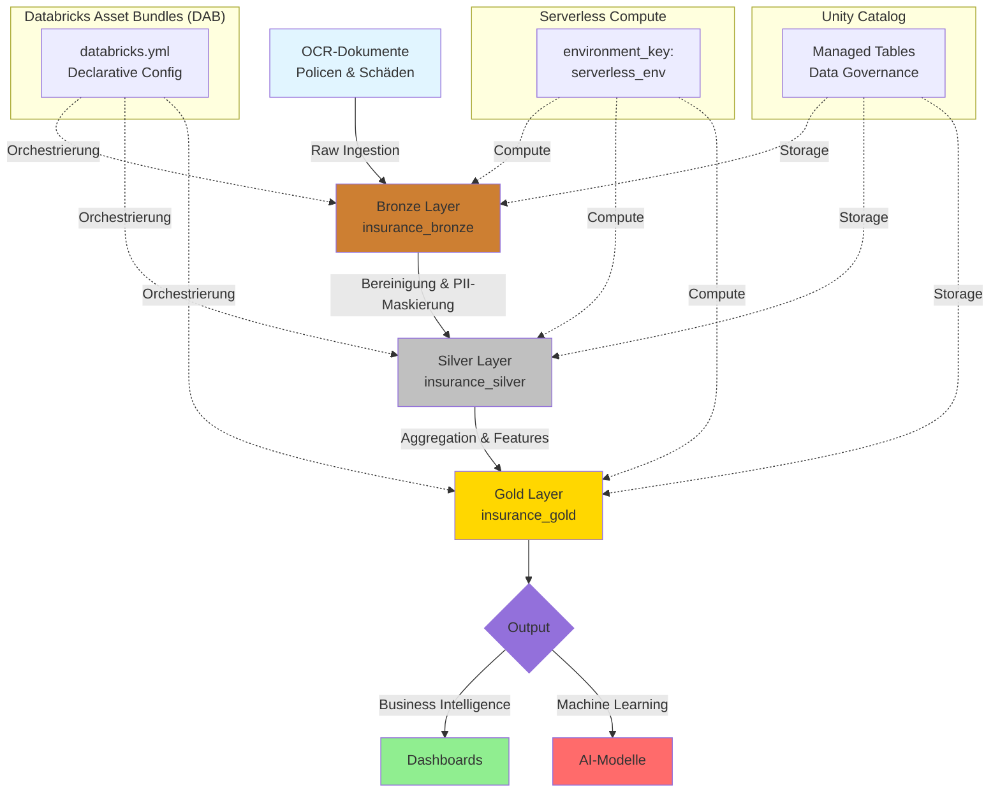

# Versicherung Dokumenten Analyse Pipeline (Databricks Asset Bundles)

## Projektübersicht

Dieses Projekt demonstriert eine moderne, deklarative Datenpipeline für die **Analyse und Verwaltung von Versicherungsdokumenten**. Es wurde speziell für den Versicherungsmarkt konzipiert und verarbeitet simulierte OCR-Rohdaten aus Schadenmeldungen und Policen.

Die Pipeline nutzt **Databricks Asset Bundles (DAB)** für CI/CD, **Serverless Compute** via `environments`, **Unity Catalog Managed Tables** und integriert **PII-Maskierung** für DSGVO-Compliance.

## Tech Stack

- **Orchestrierung:** Databricks Asset Bundles (DAB) - Deklarative Automation
- **Compute:** Databricks Serverless Compute (via `environment_key`)
- **Storage:** Unity Catalog Managed Tables
- **Sprache:** Python (PySpark) & Databricks SDK
- **Architektur:** Medallion (Bronze, Silver, Gold)
- **Compliance:** DSGVO-konforme PII-Maskierung

##  Architektur-Diagramm



## Architektur & Pipeline-Schritte

### 1. Bronze Layer (Raw Ingestion)
- Nimmt unstrukturierte OCR-Texte aus Versicherungsdokumenten auf
- Fügt Metadaten (Ingestions-Zeitstempel, Quell-System) hinzu
- Speichert als **Unity Catalog Managed Table**

### 2. Silver Layer (Bereinigung & PII Maskierung)
- Bereinigt den Text (Normalisierung, Lowercase)
- **DSGVO-Feature:** Maskiert personenbezogene Daten (PII) wie Kundennamen automatisch
- Feature-Engineering für nachgelagerte AI-Modelle (z.B. "Totalschaden"-Erkennung)

### 3. Gold Layer (Aggregation)
- Erstellt Business-Metriken (Anzahl Schäden pro Versicherungstyp, durchschnittliche Textlänge)
- Dient als Basis für BI-Dashboards und Machine-Learning-Modelltraining

##  Installation & Deployment

### Voraussetzungen
- Python 3.8+
- Databricks CLI (`pip install databricks-cli databricks-sdk`)
- Databricks Personal Access Token (PAT)

### Lokales Setup

```bash
# Projekt klonen
git clone <repo-url>
cd insurance_doc_pipeline

# Virtuelle Umgebung erstellen und aktivieren
python3 -m venv .venv
source .venv/bin/activate  # Windows: .venv\Scripts\activate

# Abhängigkeiten installieren
pip install databricks-cli databricks-sdk

# Databricks CLI authentifizieren
databricks configure --token

